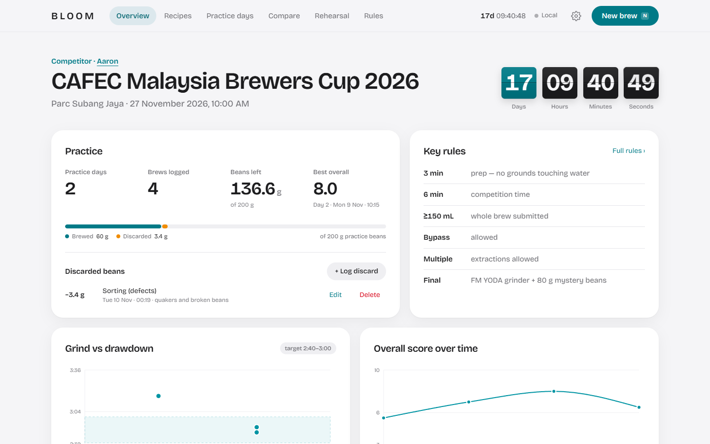
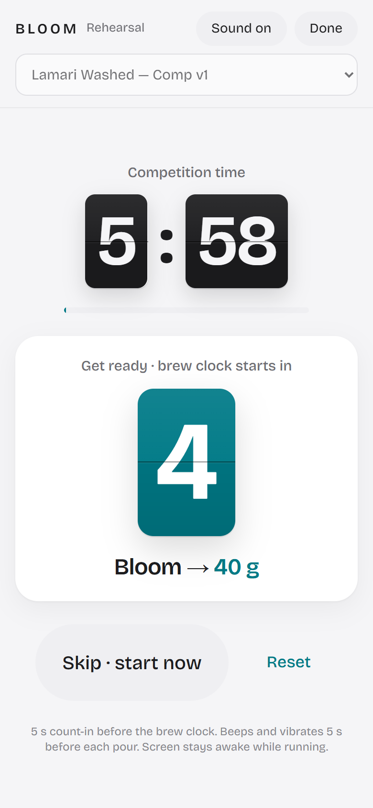
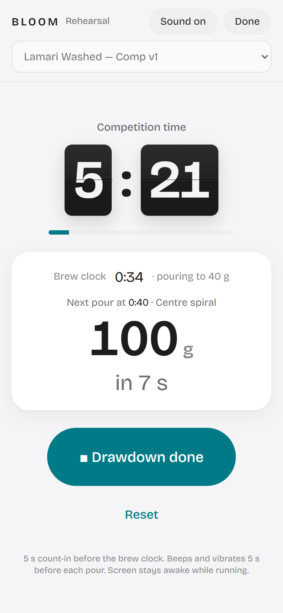
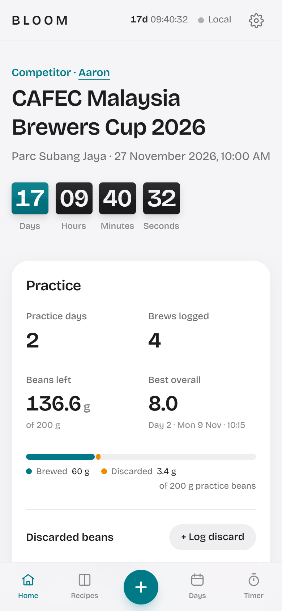
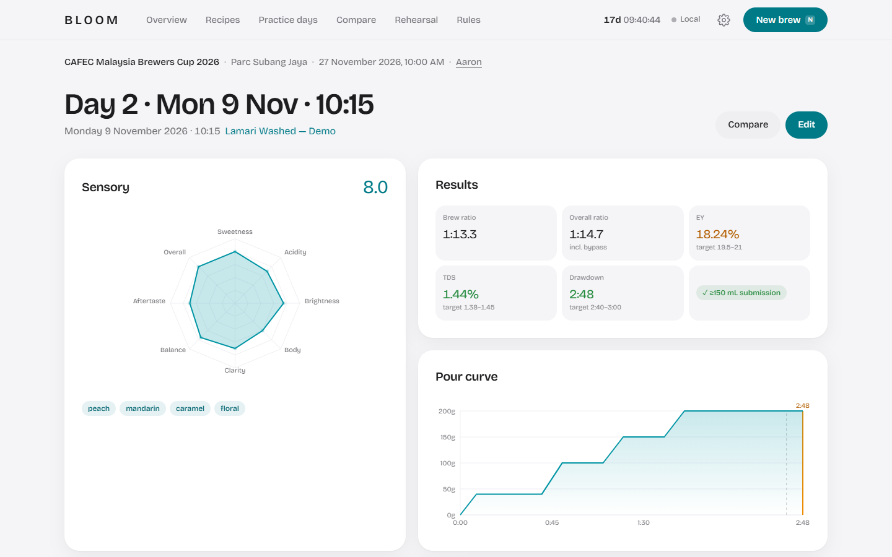
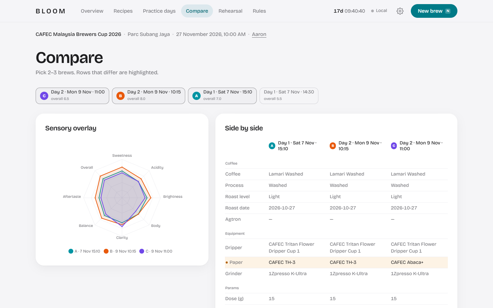

# BLOOM

**A competition practice dashboard for the CAFEC Malaysia Brewers Cup 2026.**

I'm competing in the Brewers Cup on 27 November 2026. BLOOM is where I log every practice brew, see what each tweak did to the cup, and rehearse my 6-minute routine at the brew station.

**Live:** [summit.atys.dev](https://summit.atys.dev) · Built with [Claude Code](https://claude.com/claude-code)



## Features

- **Recipes with version history**: a reusable template for every recipe. Promote a good brew straight into the next version. Includes read-only World Brewers Cup champion templates (Kasuya 4:6, Chad Wang, Matt Winton, Carlos Medina, Sherry Hsu), scaled for the CAFEC Cup 1 dripper.
- **Brew log**: each brew snapshots its recipe, so tweaks never overwrite it. Changes are highlighted against the recipe. Live brew ratio, extraction yield and a ≥150 mL submission check.
- **Sensory scoring**: eight sliders with a live radar chart, plus flavour tags.
- **Trends**: grind vs drawdown, overall score over time, and a TDS/EY brew control chart with the target box.
- **Compare**: overlay 2–3 brews on one radar, with a side-by-side spec table that highlights the differences.
- **Practice days**: a timeline with an end-of-day conclusion and next-session plan for each day.
- **Bean budget**: tracks the 200 g of practice beans across brews *and* discards (sorting defects, grinder purge, spills).
- **Rehearsal timer**: a full-screen 6:00 competition clock on split-flap cards, a 5 s count-in, pour cues in huge type, and a beep and vibration before each pour. Log the drawdown and it opens a prefilled brew.
- **Offline-first sync**: works without signal, then syncs to a Google Sheet when back online.

<table>
  <tr>
    <td width="33%"></td>
    <td width="33%"></td>
    <td width="33%"></td>
  </tr>
</table>





## Stack

- **Front end:** Vite, React, TypeScript, Tailwind CSS, Framer Motion, Recharts, date-fns-tz (all times in Asia/Kuala_Lumpur)
- **Backend:** a Google Apps Script web app over a Google Sheet. One tab per entity, with full JSON per row and last-write-wins merging.
- **Data layer:** localStorage cache, optimistic updates, and a retry queue for offline use.
- **Hosting:** Vercel

## Run it

```bash
npm install
npm run dev     # http://localhost:5173 → ⚙ Settings → "Load demo data"
```

Without a backend it runs in **Local only** mode and saves to the browser. To sync to your own Google Sheet and deploy, see **[docs/SETUP.md](docs/SETUP.md)**.

## Built with Claude Code

I built BLOOM by pairing with [Claude Code](https://claude.com/claude-code). I wrote the spec, and Claude planned the file structure, wrote the code, ran the builds and checked each screen in a headless browser. I reviewed every step and steered the direction.

**How it evolved after the first build:**

1. **First build** from the spec below: dark "competition night" theme, the full data layer, the Apps Script backend and every page.
2. **Rebrand**: moved to a clean, Apple-inspired light design and renamed it BLOOM.
3. **Colour from my dripper**: the primary colour now matches my CAFEC Tritan Flower Dripper's teal (checked for contrast and colour-blind safety).
4. **Tighter header**: title and countdown on one row, and a larger nav.
5. **Split-flap timers**: old-school flip-clock animation on the countdown and the rehearsal clock.
6. **Deployed to Vercel**: linked my name to [atys.dev](https://atys.dev) and moved secrets out of the committed example env file.
7. **Typography**: switched to Bricolage Grotesque.
8. **Discarded-bean log**: sorting losses now count against the practice bean budget.
9. **5-second count-in** before the brew clock in the rehearsal timer.

<details>
<summary><strong>My original prompt</strong> (click to expand)</summary>

```text
# Build: "Brew Lab" — competition recipe dashboard for CAFEC Malaysia Brewers Cup 2026

## Context
I'm Aaron, a front-end developer competing in the CAFEC Malaysia Brewers Cup 2026. I need a personal dashboard to track recipes and practice sessions, log what I tweaked and how it tasted, and write an end-of-day conclusion after each practice day. Single user (me), used on desktop and phone.

## Stack (use this)
- Vite + React + TypeScript, Tailwind CSS
- Framer Motion for animation, Recharts for charts
- date-fns + date-fns-tz (all times in Asia/Kuala_Lumpur)
- Backend: Google Apps Script web app + Google Sheet (code in `/apps-script/Code.gs`)
- Static deploy (Vercel/Netlify). Config through `.env`: `VITE_GAS_URL`, `VITE_GAS_TOKEN`

## Design direction
- Dark, premium, "competition night" feel: near-black espresso background (#0E0B09 range), warm off-white text, one accent in CAFEC-like golden yellow (#E8C46A), and a muted copper secondary.
- Typography: an expressive serif display font for headings (e.g. Fraunces or Instrument Serif), a clean sans for UI (Inter), and a mono for every number and measurement (JetBrains Mono). Load from Google Fonts.
- Subtle grain/noise overlay, soft glows on the accent, generous spacing, rounded cards with thin borders.
- Tasteful motion: numbers count up, cards fade/slide in, charts animate on load. Respect `prefers-reduced-motion`.
- Fully responsive; phone layout must work at the brew station (big tap targets, readable at arm's length).

## Header (always visible)
- Title: "CAFEC Malaysia Brewers Cup 2026"
- Venue: Parc Subang Jaya · Date: 27 November 2026, 10:00 AM
- Competitor: Aaron
- Live countdown to 2026-11-27 10:00 Asia/Kuala_Lumpur: days / hours / minutes / seconds, animated flip or roll digits
- All header values editable in a Settings panel (persisted to the backend)
- Small sync status indicator (Saved / Syncing / Offline)

## Data model
**Recipe** (a reusable template)
- id, name, version, notes, createdAt, updatedAt
- coffee: name, origin, process, varietals, roaster/roast machine, roastLevel (Light / Medium-light / Medium), roastDate, agtron (optional)
- equipment (defaults below, editable per recipe): dripper, paper, grinder, kettle, scale
- params: doseG, brewWaterG, bypassG, tempC, grindSetting (e.g. "7.3"), waterPpm, bloomG, bloomTimeS
- pourSchedule: editable rows of { timeS, targetWeightG, rateGps, technique }
- targets: drawdownMin/MaxS, tdsMin/Max, eyMin/Max

**Brew** (one practice brew, linked to a recipe)
- id, recipeId, dateTime (default now, editable), auto title like "Day 3 · Tue 10 Nov · 14:30" (day number counted from the first practice day; title editable)
- a snapshot of every recipe field, so tweaks don't overwrite the recipe; changed fields are highlighted vs the recipe
- results: drawdownS, beverageG (before bypass), finalG (after bypass), tdsPct (optional)
- computed (live): overall ratio, brew ratio, EY% = tdsPct × finalG ÷ doseG, plus a pass/fail badge "≥150 mL submission" (finalG ≥ 150, warn under 175)
- sensory sliders 0–10: sweetness, acidity, brightness, body, clarity, balance, aftertaste, overall
- flavour notes as tags (suggest presets: orange, mandarin, red apple, peach, apricot, brown sugar, caramel, milk chocolate, cocoa, black tea, floral)
- whatITweaked (text), feedback (text), "Promote to new recipe version" button

**PracticeDay**
- date, list of brews (derived), endOfDayConclusion (text), nextSessionPlan (text)

**Settings**: header fields, bean budget start (200 g practice beans), defaults.

## Defaults (prefill a starter recipe "Lamari Washed — Comp v1")
- Coffee: Lamari Washed, Lamari River Valley Coffee Gardens, Obura-Wonenara, Eastern Highlands, PNG; Arusha, Blue Mountain, Bourbon, Typica; washed; 1,700–2,000 masl; roasted on Stronghold S8X; roast level Light (editable)
- Equipment: CAFEC Tritan Flower Dripper Cup 1 · CAFEC TH-3 paper · 1Zpresso K-Ultra · own kettle · own scale
- Dose 15 g · brew water 200 g · bypass 20 g · 92°C · grind 7.3 · water 80 ppm (Aquacode)
- Pours: 0:00 → 40 g (bloom), 0:40 → 100 g, 1:10 → 150 g, 1:40 → 200 g
- Targets: drawdown 2:40–3:00 · TDS 1.38–1.45% · EY 19.5–21%
- Dropdown options: drippers = Tritan Flower Dripper Cup 1, Flower Dripper Deep 27; papers = Abaca, Abaca+, TH-1, TH-2, TH-3, Abaca+ Deep 27 (the competition's approved list)
- Temperature helper: Light → 92–94°C, Medium-light → 90–92°C (show as a hint next to the temp field based on roastLevel)

## Pages / views
1. **Dashboard**
   - Countdown, practice days so far, brews logged, practice beans remaining (200 g minus the sum of brew doses), current best brew (highest overall)
   - Trend charts: grind setting vs drawdown time (scatter, target band shaded); overall score over time; brew-control chart of TDS vs EY with the target box highlighted
2. **Recipes**: list, create, duplicate, edit, version history
3. **New Brew / Edit Brew** (main form)
   - Start from a recipe; every field editable inline
   - Animated temperature gauge/thermometer that animates to the set temp, colour shifting cool → hot
   - Animated pour-curve chart: water weight vs time from the pour schedule, drawn progressively
   - Sensory sliders with a live radar chart
   - Water calculator: given target ppm, show grams of Aquacode concentrate (590 ppm stock) + distilled water per 1 L (concentrate g = target ÷ 590 × 1000)
4. **Brew Detail**: read view with a radar chart, pour curve, diffs vs the recipe, notes
5. **Compare**: pick 2–3 brews; overlaid radar charts plus a side-by-side spec table with differences highlighted
6. **Practice Days**: timeline grouped by date; each day shows its brews and an editable end-of-day conclusion and next-session plan
7. **Rehearsal Timer**: full-screen 6-minute competition timer that starts from a chosen recipe, shows the next pour cue (time + target weight) in huge type, vibrates/beeps 5 s before each pour, and lets me log the drawdown time at the end, which opens a prefilled new Brew

## Backend: Google Apps Script
- One Sheet with tabs: `recipes`, `brews`, `days`, `settings`. Columns: id, updatedAt, deleted, json (store the full object as JSON for flexibility), plus a few readable columns (title, date, overall) so the Sheet is human-scannable.
- `doGet(e)`: `?action=list&token=...` returns everything as JSON.
- `doPost(e)`: body `{ action: "upsert" | "delete", entity, data, token }`. The front end must send it as `Content-Type: text/plain;charset=utf-8` to avoid a CORS preflight; parse JSON server-side.
- Validate the token against a Script Property `API_TOKEN`; reject otherwise. Use LockService for writes.
- Last-write-wins on `updatedAt`.
- Front end: a data layer with localStorage cache, optimistic updates and a retry queue when offline; it syncs on load and after each change.
- Add a short `README` section: create the Sheet, paste Code.gs, set the API_TOKEN Script Property, deploy as web app (Execute as: me, Access: anyone), copy the URL into `.env`. Note that the token is visible in the front-end bundle, which is acceptable for a personal tool.

## Extras
- Export all data as JSON and CSV; import JSON
- Keyboard shortcut N = new brew
- Empty states with helpful hints; confirm before deleting

## Working style
- Plan the component and file structure first, then build in stages: layout + design system → data layer + Apps Script → recipe/brew forms → charts/animation → compare, days, rehearsal timer → polish.
- Seed realistic demo data (2 practice days, 4 brews) behind a "Load demo data" button so I can see the charts immediately.
- Give me complete files, not snippets. Run the build, fix type errors, and tell me how to run it locally and deploy.
```

**Follow-up in the same message:**

```text
## Additions
1. **Preload champion recipe templates** in the Recipes page (tagged "Champion", read-only originals that I can duplicate and edit). Scaled for Cup 1:
   - Tetsu Kasuya 4:6 (2016, V60): 14 g / 210 g, 92°C, grind ~9.0, five pours of 42 g every 45 s
   - Chad Wang (2017, ceramic V60): 14 g / 230 g, 92°C, 30 s bloom, continuous centre pour, finish 2:00–2:10
   - Matt Winton five-pour (2021, V60): 14 g / 210 g, five pours of 42 g every 30 s, no stirring
   - Carlos Medina (2023, Origami): 14 g / 225 g, 91°C, five pours of 45 g every 30 s
   - Sherry Hsu (2022, Orea, technique only): 14 g / 200 g, first pour 70°C then 95°C, four pours of 50 g every 30 s, blended grind (75% coarse / 25% 10 clicks finer), plus 15–20 g bypass
2. **Rules page**: a "Rules" tab that embeds a PDF I'll place at `/public/rules.pdf` (inline viewer with a download button), plus a pinned "Key rules" card on the Dashboard: 3 min prep (no grounds touching water) · 6 min competition · ≥150 mL, whole brew submitted · bypass allowed · multiple extractions allowed · final round uses FM YODA grinder + 80 g mystery beans.
```

</details>

---

Made by [Aaron](https://atys.dev) for the CAFEC Malaysia Brewers Cup 2026.
